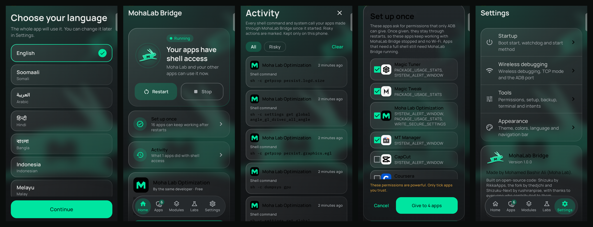

# MohaLab Bridge

Shell power for your apps, without root.

Apps that need ADB-level access (tuners, debloaters, permission managers, game optimizers) use it through MohaLab Bridge. It works with apps made for Shizuku, and it shows you what each of them does with that access.

## Download

Get the APK from the [latest release](https://github.com/7Mohan/mohalab-bridge/releases/latest). The app announces newer versions itself.

Only install MohaLab Bridge from this page or the official Telegram channel [t.me/Mohagaminglab](https://t.me/Mohagaminglab). Copies signed by anyone else will not open.

## What it does

An app cannot change system settings or grant itself special permissions on its own. With wireless debugging (Android 11 and newer), a USB cable to a computer, or root, MohaLab Bridge starts a small service with shell rights. Apps you allow can then use those rights. You decide which apps, and how much.

## What MohaLab Bridge adds

These were built for MohaLab Bridge. They are not in Shizuku or Shizuku-Next.

**Installs next to Shizuku.** MohaLab Bridge has its own package, permission and service name, so it can sit on the same phone as Shizuku or Shizuku-Next. Apps written for Shizuku work with it unchanged.

**Access per app, not all or nothing.** For every allowed app you choose what it may use: shell commands, packages, settings, permissions and app ops, activities, network, and other system services. Anything outside its scope is refused and logged.

**Activity log.** Every shell command and system call each app makes is listed with the app and the time. Risky commands (uninstalling, wiping data, changing security settings) are marked, and you can take an app's access away from the same screen. The log stays on the phone.

**Set up once.** Many apps only need a few permissions that ADB can give, such as usage access or drawing over other apps. MohaLab Bridge finds the apps that ask for them and gives them in one tap. Those permissions stay after a restart, so those apps keep working even when MohaLab Bridge is stopped and there is no Wi-Fi.

**Answers the Wi-Fi prompt for you.** Every new Wi-Fi network brings back "Allow wireless debugging on this network?". If you turn this on, MohaLab Bridge ticks "Always allow" and confirms it. It only acts on that one system window.

**Stop history.** When the service stops, MohaLab Bridge records when and why, and whether the watchdog brought it back. You see it on the home screen instead of guessing.

**Ready if loopback ADB is closed.** Android may stop accepting ADB connections from the phone itself ([Google issue 526109803](https://issuetracker.google.com/issues/526109803), a proposal for now). If it does, MohaLab Bridge connects through the phone's own Wi-Fi address instead.

**News and update notices.** A bell on the home screen shows announcements and update notes, in your language when a translation exists.

**Its own look.** Liquid-glass design in dark and light, rewritten screens, and a guided tour that walks through the real app the first time you open it.

**Eleven languages, chosen first.** English, Somali, Arabic, Hindi, Bangla, Indonesian, Malay, Filipino, Portuguese (Brazil), Vietnamese and Russian. The first screen asks which one, and every screen follows it.

## How it differs from other ADB apps

Compared with Shizuku and Shizuku-Next, the two apps other apps already use for ADB rights. From their public pages, November 2026.

| | MohaLab Bridge | Shizuku | Shizuku-Next |
|---|:---:|:---:|:---:|
| Other apps can use ADB or root rights through it (Shizuku API) | ✓ | ✓ | ✓ |
| Installs next to Shizuku on the same phone | ✓ | – | – (uses Shizuku's package) |
| Limit what each app may use (shell, packages, settings, network…) | ✓ | – (full access or none) | – (full access or none) |
| Log of every command each app ran, risky ones marked | ✓ | – | – |
| Finds apps that need ADB-only permissions and gives them in one tap | ✓ | – | partly (manual batch changes) |
| Watchdog that restarts the service | ✓ | – | ✓ |

Apps like LADB or other ADB shells give **you** a terminal. They do not let your other apps use those rights, so tuners and optimizers built for Shizuku cannot use them. MohaLab Bridge does both: apps get the rights, and you see and limit what they do.

## What it keeps from the projects it is built on

- Starting through wireless debugging (with pairing from the notification), USB with a computer, or root.
- Start on boot where the method allows it, a watchdog that restarts the service, and diagnostics when a start fails.
- Tools: terminal, app permissions and app ops, firewall, saved Wi-Fi networks, log viewer, file browser and app installer.
- Automation through intents (Tasker and similar apps).

Finding and installing modules from inside the app is marked "coming soon" while MohaLab modules are being prepared.

## Honest limits

- Without root, every phone restart needs Wi-Fi or a computer to start the service again. No app can avoid that without root.
- Wireless debugging needs the phone to be connected to a Wi-Fi network as a client. A hotspot from the same phone does not work on many devices.
- Some phone brands kill background services more aggressively. Turn off battery optimization for MohaLab Bridge if it stops when the screen is off.

## Requirements

- Android 7.0 or newer. Wireless start needs Android 11 or newer.
- For USB start: a computer with ADB.
- For root start: a rooted phone (Magisk, KernelSU or APatch).

## Privacy

MohaLab Bridge does not read or send what your apps do; the activity log never leaves the phone.

When it checks for news and updates (at most every few hours), it sends a random ID created on the phone, the app version, the phone model, the Android version and the app language. The ID is not linked to any account. This lets the developer count installs and turn off a broken version. Notifications are delivered through Firebase Cloud Messaging (Google) by topic, so no personal data is stored for them.

## Made by

**Mohamed Bashir Ali (Moha Lab)**, also the developer of Moha Lab Optimization.

- Telegram: [t.me/Mohagaminglab](https://t.me/Mohagaminglab)
- TikTok: [@professor0011110](https://www.tiktok.com/@professor0011110)
- Website: [mohagaminglab.vercel.app](https://mohagaminglab.vercel.app)

## Built on open source

MohaLab Bridge is built on the work of these people and projects, under the Apache License 2.0:

- [Shizuku](https://github.com/RikkaApps/Shizuku) by RikkaW / RikkaApps: the original app, the server and the API that compatible apps use.
- [Shizuku fork by thedjchi](https://github.com/thedjchi/Shizuku): many reliability and start features.
- [Shizuku-Next](https://github.com/rushiranpise/Shizuku-Next) by rushiranpise: the code base MohaLab Bridge starts from.
- [Nightzuku](https://github.com/kerneldroid/Nightzuku) by kerneldroid: the ADB module format.
- [Shevery](https://github.com/HmnDev-Tech/shevery), [ShizuWall](https://github.com/AhmetCanArslan/ShizuWall) by AhmetCanArslan, [Xhizuku](https://github.com/xeonleonreal/Xhizuku), [KernelSU-Next](https://github.com/KernelSU-Next/KernelSU-Next) and [MMRL](https://github.com/MMRLApp/MMRL): module API, firewall fallback and interface ideas.
- Everyone who contributed code and translations to those projects.

Their source code is available at the links above. This repository holds the app's description, screenshots and releases. See [LICENSE](LICENSE) and [NOTICE](NOTICE).

MohaLab Bridge is not affiliated with or endorsed by the Shizuku or Shizuku-Next projects.
